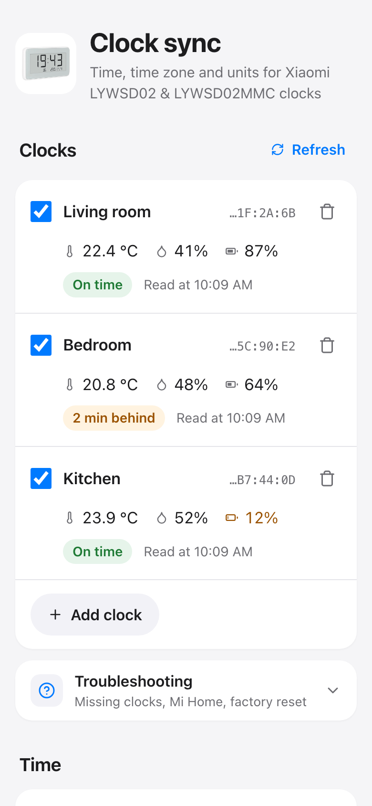
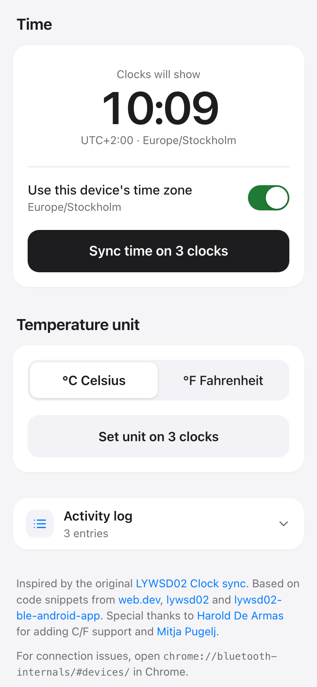

# mi-LYWSD02-clock-sync-ui

Set the time, time zone and temperature unit on your Xiaomi LYWSD02 / LYWSD02MMC Bluetooth clocks right from the browser, and check their temperature, humidity and battery while you're at it.

**Try it:** https://khromov.github.io/mi-LYWSD02-clock-sync-ui/

<table>
  <tr>
    <td></td>
    <td></td>
  </tr>
</table>

It uses Web Bluetooth, so you'll need Chrome or Edge on desktop or Android. If a clock won't show up, the app's Troubleshooting section has you covered, all the way to a factory reset.

## Good to know

- **Daylight saving time:** the clock keeps the offset it was given, so sync again after the clocks change.
- **Half-hour time zones:** the clock only understands whole hours. In places like India or Nepal, the app adds the leftover minutes to the time so the clock still shows the right local time.
- **Reconnecting after a reload:** Chrome makes you pick each clock again. Turn on `chrome://flags/#enable-experimental-web-platform-features` and the page reconnects to your saved clocks by itself. Also turn on `chrome://flags/#enable-web-bluetooth-new-permissions-backend` to keep that working after Chrome restarts.

## How clocks are found

The device chooser shows anything named `LYWSD02…`, plus devices with Xiaomi manufacturer data (company `0x038F`) carrying an LYWSD02 product id (`0x045B`, `0x2542`, `0x16E4`). The second filter is there because clocks paired with Mi Home only send encrypted adverts, without a name.

Web Bluetooth hides MAC addresses, but a clock's System ID (`0x2A23`) is its MAC in reverse byte order. That's where the address next to each clock comes from, and it's how the app knows which saved clock you picked when reconnecting.

## Development

```sh
npm install
npm run dev
```

`npm run build` creates a static site in `dist/`, prerendered with `svelte/server` so the page shows up before any JavaScript loads. Pushing to `main` deploys it to GitHub Pages.

## Credits

Inspired by the original [LYWSD02 Clock sync](https://saso5.github.io/LYWSD02-clock-sync/). Based on code snippets from [web.dev](https://web.dev/bluetooth/), [lywsd02](https://github.com/h4/lywsd02/blob/master/lywsd02/client.py) and [lywsd02-ble-android-app](https://github.com/muro-dot/lywsd02-ble-android-app). Thanks to [Harold De Armas](https://github.com/dearmash) for adding C/F support, and to [Mitja Pugelj](https://www.linkedin.com/in/mitjapugelj).
