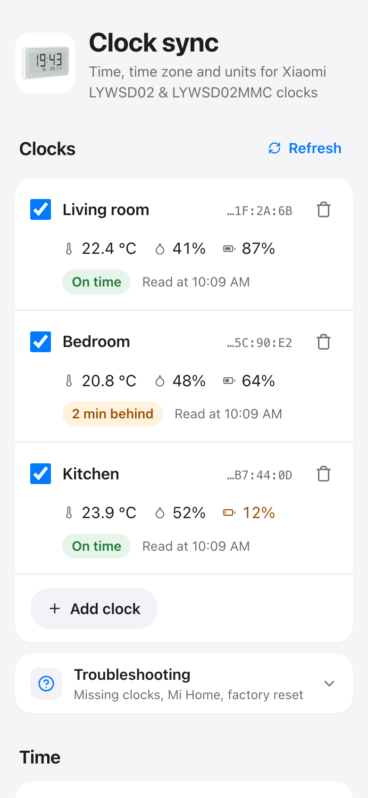
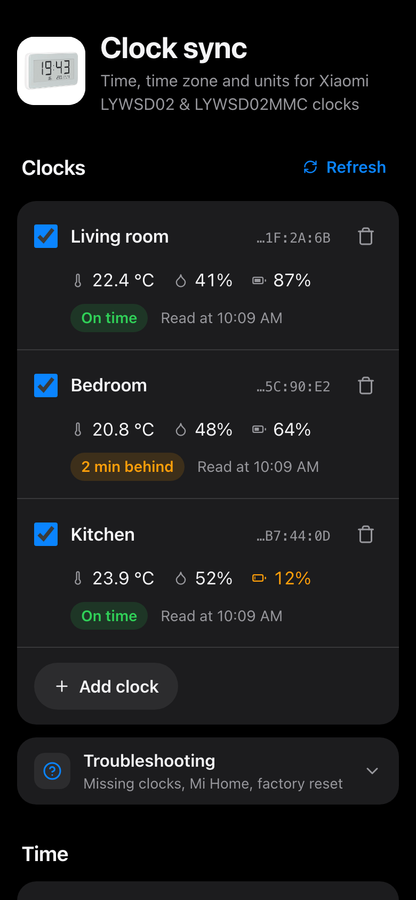

# mi-LYWSD02-clock-sync-ui

Set the time, time zone and temperature unit on one or more Xiaomi Mijia LYWSD02 / LYWSD02MMC Bluetooth clocks straight from the browser, using Web Bluetooth. Each clock's temperature, humidity, battery level and how far its time is off are shown in a list.

**Live version:** https://khromov.github.io/mi-LYWSD02-clock-sync-ui/

<table>
  <tr>
    <td></td>
    <td></td>
  </tr>
</table>

Web Bluetooth is supported in Chrome and Edge on desktop and Android. For connection issues, open `chrome://bluetooth-internals/#devices/` in Chrome.

## Multiple clocks

Browsers only let a page pick one Bluetooth device at a time, so press **Add clock** once per clock. Every action applies to the checked clocks. Click a clock's name to give it a nickname. The end of each clock's MAC address is shown next to its name; Web Bluetooth hides MAC addresses, but the clock's System ID (`0x2A23`) is the MAC in reverse byte order. On macOS, the addresses in Chrome's device chooser are not real MACs: Chrome shows the first 6 bytes of a SHA-256 hash of the CoreBluetooth peripheral UUID, which is different on every Mac.

The chooser lists devices whose name starts with `LYWSD02`, plus devices whose Xiaomi manufacturer data (company `0x038F`) carries an LYWSD02 / LYWSD02MMC product id (`0x045B`, `0x2542`, `0x16E4`). The second filter is needed because clocks bound to Mi Home only send encrypted adverts without a name.

The list, nicknames and last readings are saved in localStorage. After a reload:

- By default, Chrome no longer gives the page access to the clocks, so each one shows a **Reconnect** button that opens the chooser again. The picked clock is recognized by a hash of its System ID (`0x2A23`), so it's matched to the right entry even after a browser restart or if you pick a different clock than the row you clicked.
- With `chrome://flags/#enable-experimental-web-platform-features` (and `chrome://flags/#enable-web-bluetooth-new-permissions-backend` to keep access across browser restarts), the page uses `navigator.bluetooth.getDevices()` to reconnect to all saved clocks automatically.

## Troubleshooting

- A clock that's connected to something else (the Mi Home app, a hub, Home Assistant) stops advertising and won't show up.
- Clocks bound to Mi Home can still be synced (confirmed on an LYWSD02MMC); they just don't advertise a name.
- As a last resort, factory reset the clock. From the LYWSD02MMC manual: remove the back cover and, while the clock is running, connect the "Reset" and "Gnd" metal points near a battery with a metal conductor for more than 7 seconds. The clock restarts with factory settings. Delete it in the Mi Home app if it was set up there.

## Time zones

The clock stores the time as a UTC timestamp plus a whole-hour zone. For zones with a 30 or 45 minute offset (e.g. India, Newfoundland, Nepal), the leftover minutes are added to the timestamp so the clock shows the correct local time. Daylight saving time is applied when syncing, so re-sync after a DST change.

## Development

```sh
npm install
npm run dev
```

`npm run build` outputs a static site to `dist/`. After the client build, `scripts/prerender.js` renders the page with `svelte/server` into `dist/index.html`, so all text is in the HTML before any JavaScript runs; the client then hydrates it. Anything that depends on the visitor's browser (time zone, current time, saved clocks, Bluetooth support) is filled in on mount. Pushing to `main` deploys to GitHub Pages via `.github/workflows/deploy.yml`.

## Credits

Inspired by the original [LYWSD02 Clock sync](https://saso5.github.io/LYWSD02-clock-sync/). Based on code snippets from [web.dev](https://web.dev/bluetooth/), [lywsd02](https://github.com/h4/lywsd02/blob/master/lywsd02/client.py) and [lywsd02-ble-android-app](https://github.com/muro-dot/lywsd02-ble-android-app). Thanks to [Harold De Armas](https://github.com/dearmash) for adding C/F support and [Mitja Pugelj](https://www.linkedin.com/in/mitjapugelj).
